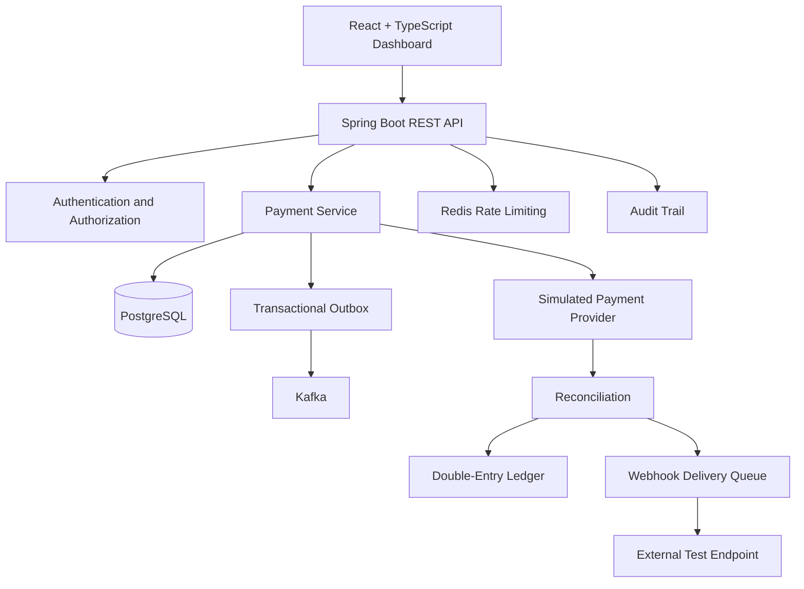
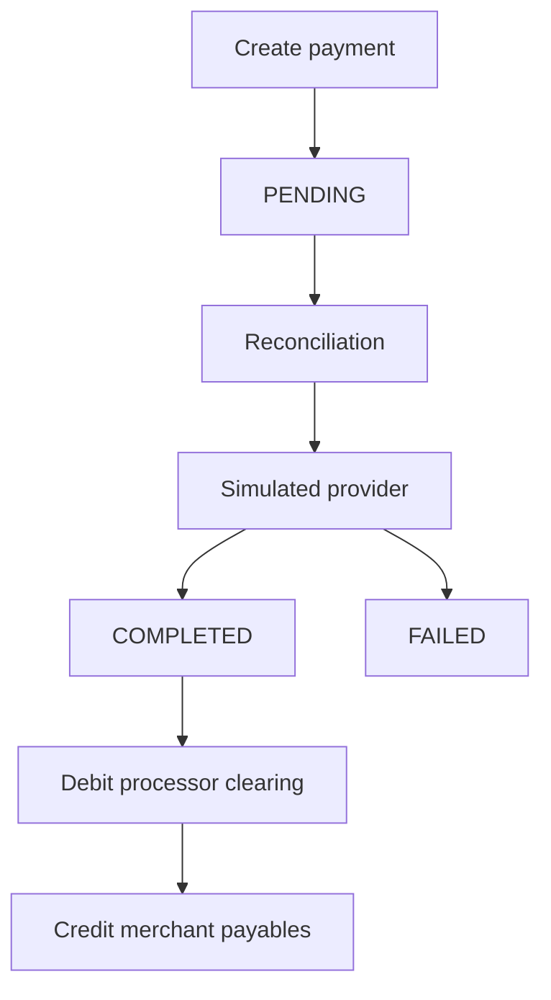

# FluxPay — Payment Processing & Reconciliation Sandbox

FluxPay is a full-stack payment-processing and operations dashboard built to demonstrate backend engineering, transaction management, event-driven architecture, and financial ledger design.

It uses **simulated payment-provider outcomes only**. It does not connect to a real payment network or move real money.

## Features

### Backend and API
- Java 21 and Spring Boot 4.1.1
- User registration and login with BCrypt password hashing and JWT access tokens
- Authenticated, user-scoped payment listing and retrieval
- Request validation, consistent API errors, and payment-state transition rules
- Idempotency checks to prevent duplicate payment creation
- PostgreSQL persistence with versioned Flyway database migrations
- Spring Data JPA repositories and transactional service operations
- Health checks with Spring Boot Actuator
- OpenAPI documentation and Swagger UI

### Payment processing
- Simulated payment provider and reconciliation workflow
- Payment lifecycle management, including pending, completed, and failed states
- Double-entry ledger entries for completed payments
- Ledger balance checks and stable keys for duplicate-entry protection
- Transactional outbox for tracking events intended for Kafka publication
- Kafka topics for payment-created and payment-status-changed events
- Redis-backed fixed-window rate limiting with an in-memory development fallback

### Webhooks and audit
- HTTPS webhook endpoint registration; HTTP is allowed only for loopback addresses
- HMAC-SHA256 signed webhook payloads
- Webhook delivery history and retry scheduling with exponential backoff
- Per-account audit events for important application activities

### Frontend and deployment
- React and TypeScript operations dashboard
- Payments, ledger, webhook, and audit-trail views
- Docker Compose for local services
- Multi-stage Docker builds for the API and frontend
- GitHub Actions workflow for continuous integration

## Architecture



This is a simplified logical architecture. Actual asynchronous processing and delivery behavior should be validated against the current configuration and tests.

## Technology stack

| Component | Technology |
|---|---|
| Language | Java 21 |
| Backend | Spring Boot 4.1.1 |
| API | REST, OpenAPI, Swagger UI |
| Authentication | Spring Security, BCrypt, JWT |
| Database | PostgreSQL |
| Schema migrations | Flyway |
| Messaging | Apache Kafka |
| Rate limiting | Redis |
| Frontend | React, TypeScript, Vite |
| Web server | Nginx |
| Containers | Docker, Docker Compose |
| CI | GitHub Actions |

## Quick start with Docker

### Prerequisites

- Docker Desktop installed and running
- Docker Compose enabled
- Internet access for initial image and dependency downloads

### 1. Get the project

Clone the repository:

```bash
git clone https://github.com/Prasanna9145/fluxpay.git
cd fluxpay
```

### 2. Configure environment variables

Create a local environment file from the provided template.

On Windows PowerShell:

```powershell
Copy-Item .env.example .env
notepad .env
```

On macOS or Linux:

```bash
cp .env.example .env
```

Set a unique local database password and replace the JWT secret with a securely generated random value of at least 32 bytes.

**Never commit `.env` or share its contents.** The repository's `.gitignore` excludes this file.

The values in `.env.example` are placeholders and should be changed before starting the stack.

### 3. Build and start the application

From the repository root, run:

```bash
docker compose up --build -d
```

Check service status:

```bash
docker compose ps
```

Inspect API logs if necessary:

```bash
docker compose logs --tail=100 api
```

Follow live logs:

```bash
docker compose logs -f api
```

### 4. Open the application

| Service | URL |
|---|---|
| Dashboard | http://localhost:4173 |
| API | http://localhost:8080 |
| Swagger UI | http://localhost:8080/swagger-ui.html |
| OpenAPI JSON | http://localhost:8080/v3/api-docs |
| Actuator health | http://localhost:8080/actuator/health |

Register a demo account, sign in, create a test payment, and run reconciliation through the dashboard.

The provider is simulated. Outcomes are designed for repeatable demonstrations; a completed payment is not proof of a real bank transfer or settlement.

### 5. Stop the application

Stop the services:

```bash
docker compose down
```

To also delete local database and broker data volumes:

```bash
docker compose down -v
```

**Warning:** The `-v` option permanently removes the associated local Docker volumes and their stored demo data. Do not use it unless you intend to reset that data.

## Run the backend directly

This mode is intended for development. Docker is still used for supporting infrastructure.

### 1. Start infrastructure

From the repository root:

```bash
docker compose up -d postgres redis kafka
```

### 2. Configure environment variables

Example for Windows PowerShell:

```powershell
$env:DB_URL = "jdbc:postgresql://localhost:5432/fluxpay"
$env:DB_USERNAME = "postgres"
$env:DB_PASSWORD = "your-local-password"
$env:APP_JWT_SECRET = "replace-with-at-least-32-random-bytes"
$env:KAFKA_BOOTSTRAP_SERVERS = "localhost:9092"
$env:REDIS_HOST = "localhost"
```

Use the same database password configured for the PostgreSQL service in Docker Compose.

Never reuse demo credentials in a production environment.

### 3. Run Spring Boot

On Windows:

```powershell
.\mvnw.cmd spring-boot:run
```

On macOS or Linux:

```bash
./mvnw spring-boot:run
```

The API should be available at `http://localhost:8080` after startup completes.

## Run the frontend directly

Use a recent Node.js installation.

From the repository root:

```bash
cd frontend
npm install
npm run dev
```

Vite normally serves the development dashboard at:

http://localhost:5173

The frontend uses `http://localhost:8080` as its default API base URL. Configure `VITE_API_BASE_URL` at build time if your API runs elsewhere. The backend's permitted browser origins are controlled by `CORS_ALLOWED_ORIGINS`.

### Production frontend build

From the `frontend` directory:

```bash
npm run build
```

The build script runs the TypeScript check before generating the production assets with Vite.

## API reference

Except for registration and login, the API endpoints below require a valid access token in the `Authorization: Bearer <token>` header.

| Method | Endpoint | Purpose |
|---|---|---|
| GET | `/api/v1/health` | Basic health response |
| POST | `/api/v1/auth/register` | Register a user |
| POST | `/api/v1/auth/login` | Authenticate and issue a JWT |
| GET | `/api/v1/dashboard/summary` | Payment counts and completed volume by currency |
| POST | `/api/v1/payments` | Create a payment |
| GET | `/api/v1/payments` | List the authenticated user's payments |
| GET | `/api/v1/payments/{id}` | Retrieve one of the user's payments |
| PATCH | `/api/v1/payments/{id}/status` | Request a status change allowed by the transition rules |
| POST | `/api/v1/reconciliation/run` | Process eligible payments using the simulated provider |
| GET | `/api/v1/ledger` | List ledger entries |
| GET | `/api/v1/ledger/payments/{paymentId}` | List ledger entries for a payment |
| POST | `/api/v1/webhooks` | Register a webhook endpoint |
| GET | `/api/v1/webhooks` | List registered webhook endpoints |
| GET | `/api/v1/webhooks/deliveries` | View webhook delivery and retry history |
| GET | `/api/v1/audit` | View the authenticated user's audit events |
| GET | `/v3/api-docs` | OpenAPI specification |
| GET | `/swagger-ui.html` | Swagger UI |

Consult Swagger UI for the current request schemas and response formats.

## Example: create a test payment with PowerShell

Start the application and make sure its API is available before running this example.

```powershell
$body = @{
    username = "demo_user"
    password = "change-this-demo-password"
} | ConvertTo-Json

Invoke-RestMethod `
    -Method Post `
    -Uri "http://localhost:8080/api/v1/auth/register" `
    -ContentType "application/json" `
    -Body $body

$login = Invoke-RestMethod `
    -Method Post `
    -Uri "http://localhost:8080/api/v1/auth/login" `
    -ContentType "application/json" `
    -Body $body

$headers = @{
    Authorization = "Bearer $($login.token)"
    "Idempotency-Key" = [guid]::NewGuid().ToString()
}

$payment = @{
    amount = 1250.00
    currency = "INR"
    customerEmail = "customer@example.com"
} | ConvertTo-Json

Invoke-RestMethod `
    -Method Post `
    -Uri "http://localhost:8080/api/v1/payments" `
    -Headers $headers `
    -ContentType "application/json" `
    -Body $payment

Invoke-RestMethod `
    -Method Post `
    -Uri "http://localhost:8080/api/v1/reconciliation/run" `
    -Headers @{ Authorization = "Bearer $($login.token)" }
```

Use a new username if `demo_user` already exists. The example uses fictional payment data and does not move real money.

## Idempotency

Payment creation accepts an `Idempotency-Key` header.

The intended behavior is:

- Repeating a request with the same key and the same payload returns the original payment rather than creating a duplicate.
- Reusing the key with a different payload is rejected with `409 Conflict`.

Idempotency is important when clients retry requests after network failures. Concurrent requests and failure-recovery behavior should also be tested before relying on this design in a production system.

## Payment lifecycle and ledger



For a completed test payment, the ledger records equal-value entries in opposite directions:

- Debit: processor clearing
- Credit: merchant payables

For the sample INR 1,250 payment, the debit and credit entries should each be INR 1,250, keeping the ledger balanced.

These records model payment accounting. They do not mean that money has actually settled with a bank or payment provider.

## Configuration and secrets

The following environment variables are relevant to local configuration:

| Variable | Purpose |
|---|---|
| `DB_URL` | PostgreSQL JDBC connection URL |
| `DB_USERNAME` | Database username |
| `DB_PASSWORD` | Database password |
| `APP_JWT_SECRET` | Secret used to sign JWT access tokens |
| `KAFKA_BOOTSTRAP_SERVERS` | Kafka broker addresses |
| `REDIS_HOST` | Redis hostname |
| `REDIS_PORT` | Redis port |
| `CORS_ALLOWED_ORIGINS` | Permitted browser origins |
| `RATE_LIMIT_AUTH_PER_MINUTE` | Authentication rate limit |
| `RATE_LIMIT_PAYMENT_PER_MINUTE` | Payment request rate limit |
| `VITE_API_BASE_URL` | Frontend API URL at build time |

Use unique secrets in every environment. Keep credentials out of source code, frontend bundles, screenshots, logs, issues, and public documentation.

The `.env.example` file contains placeholders only. The local `.env` file should remain untracked.

## Tests and verification

### Verified locally

The following checks were completed on the development machine in October 2026:

- `.\mvnw.cmd test` completed with `BUILD SUCCESS`.
- `docker compose build api` completed successfully after adding the Spring Boot Flyway starter.
- The frontend Docker image built successfully. A later explicit frontend build reused Docker's cached build layer; a fresh uncached build is a useful additional check.
- Docker Compose started the API, frontend, PostgreSQL, Redis, and Kafka containers. PostgreSQL and Redis reported healthy.
- Flyway successfully applied migrations V1 and V2, and the Spring Boot API started.
- The database contained eight tables: `app_users`, `audit_events`, `flyway_schema_history`, `ledger_entries`, `outbox_events`, `payments`, `webhook_deliveries`, and `webhook_endpoints`.
- Manual UI checks covered registration, login, simulated INR 1,250 payment creation, reconciliation to `COMPLETED`, balanced ledger entries, and audit events.
- A webhook smoke test confirmed delivery of a payment-created event. A payment-changed event remained pending at the last check, so webhook delivery and retry behavior still require further verification.

### Repeat the checks

Backend tests:

```powershell
.\mvnw.cmd test
```

Fresh frontend build without Docker's build cache:

```powershell
docker compose build frontend --no-cache
```

Inspect service health:

```powershell
docker compose ps
```

Review `VERIFICATION.md` for the current summary of completed checks and remaining validation tasks.

These checks establish a working local demonstration, not complete production readiness. Webhook retries, failure paths, concurrency, idempotency under concurrent requests, Kafka processing, security, and comprehensive integration/end-to-end testing still need further validation.

## Continuous integration

The `.github/workflows/ci.yml` workflow is configured to run backend tests and the frontend type-check/build on pushes and pull requests.

Review the **Actions** tab in GitHub after pushing changes to confirm that the workflow completes successfully. A successful local build does not automatically mean the remote CI workflow passed.

## Security and production limitations

FluxPay is an educational portfolio sandbox, not a production payment processor. It is not PCI-certified and must not be used to handle real payments, real customer financial data, or production credentials.

A production implementation would need, among other things:

- A formal threat model and independent security review
- Managed secrets and key rotation
- Hardened webhook egress controls and robust retry/dead-letter handling
- Durable messaging configuration and recovery procedures
- Database backup and restore testing
- Alerting, observability, retention policies, and operational reconciliation procedures
- Comprehensive concurrency, integration, load, and end-to-end testing

## License

This project is licensed under the MIT License. See [LICENSE](LICENSE).
