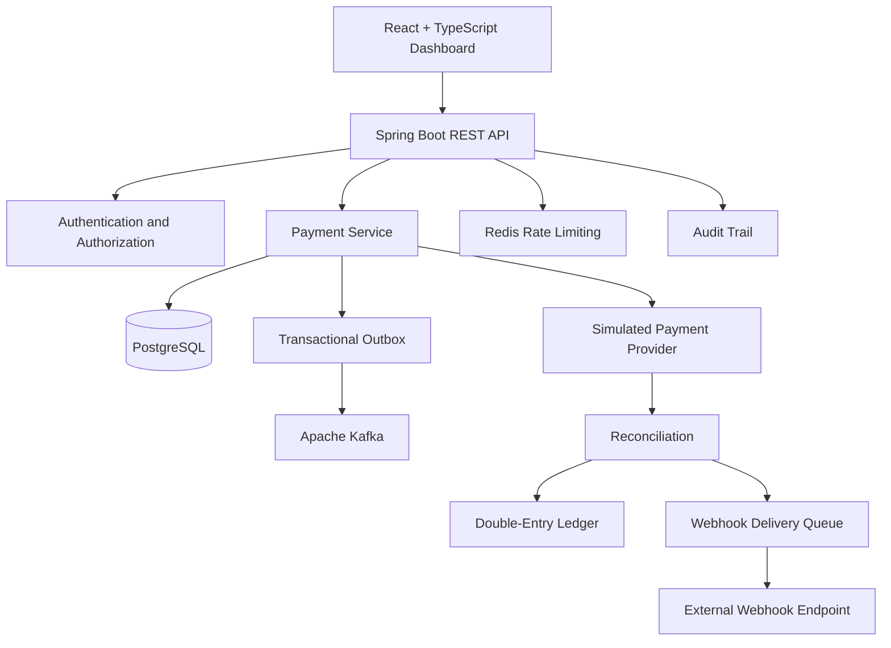

# FluxPay — Payment Processing & Reconciliation Sandbox

FluxPay is a full-stack payment-processing and reconciliation sandbox built to demonstrate backend engineering, transaction management, ledger accounting, event-driven architecture, and modern frontend development.

The application provides a dashboard for managing simulated payments, reviewing ledger entries, running reconciliation, configuring webhooks, and inspecting audit events.

> **Important:** FluxPay is an educational portfolio project. Payment-provider outcomes are simulated. It does not process real bank transfers or move real money.

## 🚀 Live Demo

| Resource | Link |
|---|---|
| **Live Application** | [Open FluxPay Dashboard](https://fluxpay-frontend-prasanna.onrender.com) |
| **Backend API** | [FluxPay API on Render](https://fluxpay-xdck.onrender.com) |
| **API Health** | [Check API Health](https://fluxpay-xdck.onrender.com/actuator/health) |
| **Swagger UI** | [Explore API Documentation](https://fluxpay-xdck.onrender.com/swagger-ui.html) |
| **GitHub Repository** | [Prasanna9145/fluxpay](https://github.com/Prasanna9145/fluxpay) |

The live application has been manually tested by the project maintainer for registration, login, dashboard data, and the main payment workflows.

**Hosting note:** The live demo uses free hosting and may take longer to respond after a period of inactivity.

## ✨ Features

### Authentication and API

- User registration and login
- BCrypt password hashing
- JWT-based authentication
- Authenticated, user-scoped payment operations
- Request validation and consistent API error handling
- Payment-state transition rules
- Idempotency support for payment creation
- PostgreSQL persistence
- Flyway database migrations
- Spring Boot Actuator health endpoint
- OpenAPI specification and Swagger UI

### Payment processing and reconciliation

- Simulated payment-provider integration
- Payment lifecycle management: `PENDING`, `COMPLETED`, and `FAILED`
- Manual reconciliation workflow
- Double-entry ledger entries for completed payments
- Ledger balance validation
- Stable keys designed to prevent duplicate ledger entries
- Transactional outbox for events intended for publication
- Kafka integration for payment-related events
- Redis-backed fixed-window rate limiting, with an in-memory fallback when Redis is unavailable

### Webhooks and audit

- Webhook endpoint registration
- HMAC-SHA256 signed webhook payloads
- Webhook delivery history
- Retry scheduling with exponential backoff
- HTTPS webhook support; HTTP is restricted to loopback addresses
- Audit events for important application activities

### Frontend and deployment

- Responsive React and TypeScript dashboard
- Payment list and payment details
- Ledger and reconciliation views
- Webhook management and delivery history
- Audit-trail interface
- Docker and Docker Compose support
- Multi-stage Docker builds
- GitHub Actions continuous-integration workflow
- Public frontend and backend deployment

## 🖥️ Dashboard Preview

Open the [live FluxPay dashboard](https://fluxpay-frontend-prasanna.onrender.com) to explore the application.

The interface provides a central view of payment activity, ledger information, reconciliation, webhooks, and audit events.

## 🏗️ Architecture



The diagram represents the intended application architecture. Kafka and Redis are included in the local Docker Compose environment. The live deployment's messaging and cache capabilities depend on the services configured for that environment.

## 🛠️ Technology Stack

| Component | Technology |
|---|---|
| Language | Java 21 |
| Backend | Spring Boot 4.1.1 |
| API | REST, OpenAPI, Swagger UI |
| Security | Spring Security, BCrypt, JWT |
| Database | PostgreSQL |
| Database migrations | Flyway |
| ORM | Spring Data JPA, Hibernate |
| Messaging | Apache Kafka |
| Rate limiting | Redis |
| Frontend | React 19, TypeScript |
| Frontend tooling | Vite |
| Web server | Nginx |
| Containers | Docker, Docker Compose |
| Hosting | Render |
| Cloud database | Neon PostgreSQL |
| CI | GitHub Actions |

## ⚙️ Run Locally with Docker

### Prerequisites

Install the following before starting:

- Git
- Docker Desktop
- Docker Compose
- Internet access for downloading dependencies and container images

### 1. Clone the repository

```bash
git clone https://github.com/Prasanna9145/fluxpay.git
cd fluxpay
```

### 2. Configure environment variables

On Windows PowerShell:

```powershell
Copy-Item .env.example .env
notepad .env
```

On macOS or Linux:

```bash
cp .env.example .env
```

Configure a unique local database password and replace the JWT secret with a securely generated random value of at least 32 bytes.

Use local development credentials only.

**Never commit `.env`, database passwords, JWT secrets, or other credentials to GitHub.** The `.env` file should remain untracked.

### 3. Build and start the application

From the repository root:

```bash
docker compose up --build -d
```

Check the service status:

```bash
docker compose ps
```

Inspect the backend logs if the API does not start:

```bash
docker compose logs --tail=100 api
```

To follow the backend logs continuously:

```bash
docker compose logs -f api
```

### 4. Open the local application

| Service | URL |
|---|---|
| Dashboard | http://localhost:4173 |
| Backend API | http://localhost:8080 |
| Swagger UI | http://localhost:8080/swagger-ui.html |
| OpenAPI JSON | http://localhost:8080/v3/api-docs |
| Actuator health | http://localhost:8080/actuator/health |

Register a demo account, sign in, create a simulated payment, and run reconciliation through the dashboard.

### 5. Stop the application

Stop the containers:

```bash
docker compose down
```

To delete the associated local database and broker volumes as well:

```bash
docker compose down -v
```

**Warning:** The second command permanently deletes data stored in those Docker volumes. Only use it when you intend to reset the local environment.

## 💻 Development Without Dockerizing the API

Docker is still used for supporting infrastructure in this mode.

### 1. Start PostgreSQL, Redis, and Kafka

From the repository root:

```bash
docker compose up -d postgres redis kafka
```

### 2. Configure backend environment variables

Example for Windows PowerShell:

```powershell
$env:DB_URL = "jdbc:postgresql://localhost:5432/fluxpay"
$env:DB_USERNAME = "postgres"
$env:DB_PASSWORD = "your-local-password"
$env:APP_JWT_SECRET = "replace-with-at-least-32-random-bytes"
$env:KAFKA_BOOTSTRAP_SERVERS = "localhost:9092"
$env:REDIS_HOST = "localhost"
$env:REDIS_PORT = "6379"
```

Use the database credentials configured in your local Docker Compose environment. Do not reuse these demo credentials in a production environment.

### 3. Run Spring Boot

On Windows:

```powershell
.\mvnw.cmd spring-boot:run
```

On macOS or Linux:

```bash
./mvnw spring-boot:run
```

The backend should become available at `http://localhost:8080` after successful startup.

## 🎨 Run the Frontend Separately

Install a recent Node.js version.

From the repository root:

```bash
cd frontend
npm install
npm run dev
```

Vite normally serves the dashboard at:

http://localhost:5173

The frontend uses `http://localhost:8080` as its default API base URL. When the API runs at a different address, set `VITE_API_BASE_URL` before building the frontend.

For example, a local PowerShell session can use:

```powershell
$env:VITE_API_BASE_URL = "http://localhost:8080"
npm run build
```

The backend's allowed browser origins are controlled by `CORS_ALLOWED_ORIGINS`.

### Build the production frontend

From the `frontend` directory:

```bash
npm run build
```

The build runs the TypeScript check and generates the production assets using Vite.

## 📡 API Reference

Except for registration and login, the endpoints below require a valid access token in the `Authorization: Bearer <token>` header.

| Method | Endpoint | Purpose |
|---|---|---|
| GET | `/api/v1/health` | Basic health response |
| POST | `/api/v1/auth/register` | Register a user |
| POST | `/api/v1/auth/login` | Authenticate and issue a JWT |
| GET | `/api/v1/dashboard/summary` | Payment summary and completed volume |
| POST | `/api/v1/payments` | Create a payment |
| GET | `/api/v1/payments` | List the authenticated user's payments |
| GET | `/api/v1/payments/{id}` | Retrieve a payment |
| PATCH | `/api/v1/payments/{id}/status` | Request an allowed payment status change |
| POST | `/api/v1/reconciliation/run` | Reconcile eligible payments |
| GET | `/api/v1/ledger` | List ledger entries |
| GET | `/api/v1/ledger/payments/{paymentId}` | List ledger entries for a payment |
| POST | `/api/v1/webhooks` | Register a webhook endpoint |
| GET | `/api/v1/webhooks` | List registered webhook endpoints |
| GET | `/api/v1/webhooks/deliveries` | View delivery and retry history |
| GET | `/api/v1/audit` | View audit events |
| GET | `/v3/api-docs` | OpenAPI specification |
| GET | `/swagger-ui.html` | Swagger UI |

Use Swagger UI to inspect the current request schemas and response formats.

## 🔁 Payment Idempotency

Payment creation accepts an `Idempotency-Key` header.

The intended behavior is:

- Repeating a request with the same key and payload returns the original payment rather than creating a duplicate.
- Reusing a key with a different payload is rejected with `409 Conflict`.

Idempotency helps clients safely retry requests after network failures. Concurrency and failure-recovery behavior still require thorough testing before production use.

## 📒 Payment Lifecycle and Double-Entry Ledger

A typical simulated payment flow is:

1. A user creates a payment.
2. The payment begins in the `PENDING` state.
3. Reconciliation invokes the simulated payment provider.
4. The payment transitions to `COMPLETED` or `FAILED`, according to the simulated result.
5. Completed payments produce corresponding ledger entries.

For a completed INR 1,250 test payment, the ledger is designed to record:

| Entry | Account | Amount |
|---|---|---:|
| Debit | Processor clearing | ₹1,250 |
| Credit | Merchant payables | ₹1,250 |

Equal debit and credit entries maintain the accounting balance for the simulated transaction.

These entries represent modeled payment accounting. They are not proof of an actual bank transfer, settlement, or movement of money.

## 🔐 Configuration and Secrets

The following environment variables are relevant to local development and deployment:

| Variable | Purpose |
|---|---|
| `DB_URL` | PostgreSQL JDBC connection URL |
| `DB_USERNAME` | Database username |
| `DB_PASSWORD` | Database password |
| `APP_JWT_SECRET` | Secret used to sign JWT tokens |
| `SERVER_PORT` | Backend listening port |
| `KAFKA_BOOTSTRAP_SERVERS` | Kafka broker address or addresses |
| `REDIS_HOST` | Redis hostname |
| `REDIS_PORT` | Redis port |
| `CORS_ALLOWED_ORIGINS` | Permitted browser origins |
| `RATE_LIMIT_AUTH_PER_MINUTE` | Authentication rate limit |
| `RATE_LIMIT_PAYMENT_PER_MINUTE` | Payment request rate limit |
| `VITE_API_BASE_URL` | Frontend API base URL, configured at build time |
| `OUTBOX_POLL_INTERVAL_MS` | Outbox polling interval |
| `WEBHOOK_POLL_INTERVAL_MS` | Webhook polling interval |
| `WEBHOOK_MAX_ATTEMPTS` | Maximum webhook delivery attempts |
| `WEBHOOK_RETRY_BASE_SECONDS` | Base delay for webhook retries |

For hosted environments, configure secrets through the hosting provider's environment-variable settings. Never place secrets in frontend variables, public documentation, source code, screenshots, or commit history.

Use a unique JWT secret and database password for each environment.

## ✅ Testing and Verification

The following checks have been reported during development or manual testing:

- Backend Maven tests completed successfully in the local environment.
- Docker images were built for the backend and frontend.
- Docker Compose started the API, frontend, PostgreSQL, Redis, and Kafka locally.
- PostgreSQL reported healthy and the API connected successfully.
- Flyway validated the database migrations and the application started.
- Manual UI checks covered registration, login, payment creation, reconciliation, ledger entries, and audit events.
- A webhook smoke test confirmed that an external endpoint could receive a test request.
- The frontend and backend were deployed publicly, and the project maintainer reported that login, dashboard data, and the main application workflows worked in the live demo.

### Repeat local checks

Backend tests:

```powershell
.\mvnw.cmd test
```

Build the frontend Docker image without using the cache:

```powershell
docker compose build frontend --no-cache
```

Inspect running containers:

```powershell
docker compose ps
```

Review [`VERIFICATION.md`](VERIFICATION.md) for the current verification notes and remaining validation work.

These checks support a working educational demonstration. They do not establish complete production readiness, and the project has not been independently security-audited.

## 🔄 Continuous Integration

The repository includes a GitHub Actions workflow at `.github/workflows/ci.yml`.

The workflow is configured to run backend tests and frontend type-check/build steps on pushes and pull requests.

Review the **Actions** tab in GitHub to confirm the current CI result. A successful local build does not automatically prove that the remote workflow has passed.

## ☁️ Deployment

The public demo is split across these services:

| Component | Hosting |
|---|---|
| React frontend | Render Static Site |
| Spring Boot API | Render Web Service |
| PostgreSQL database | Neon |

The frontend is configured to call the public API through `VITE_API_BASE_URL`. The API's allowed browser origin is controlled by `CORS_ALLOWED_ORIGINS`.

The local Docker Compose environment also includes Kafka and Redis. To deploy the full event-driven architecture in the cloud, configure reachable managed Kafka and Redis services and provide their connection settings to the backend. Do not assume that local supporting services are automatically available to the hosted application.

Free hosting may sleep when idle, impose resource limits, or have service-specific usage restrictions.

## ⚠️ Security and Production Limitations

FluxPay is an educational payment sandbox, not a production payment processor. It is not PCI-certified and must not be used to handle real payments, real customer financial data, or production credentials.

A real financial application would require additional work, including:

- Formal threat modeling and independent security review
- Strong secret management and key rotation
- Durable messaging and dead-letter/recovery procedures
- Robust webhook retry, monitoring, and failure handling
- Database backup and restoration testing
- Concurrency, idempotency, integration, load, and end-to-end tests
- Alerting, observability, audit retention, and operational reconciliation procedures
- Production-grade identity, access control, incident response, and compliance processes

## 📄 License

This project is licensed under the MIT License. See [`LICENSE`](LICENSE).

---

Built as a software engineering portfolio project to explore payment APIs, transaction workflows, double-entry accounting, event-driven systems, webhooks, and full-stack development.
