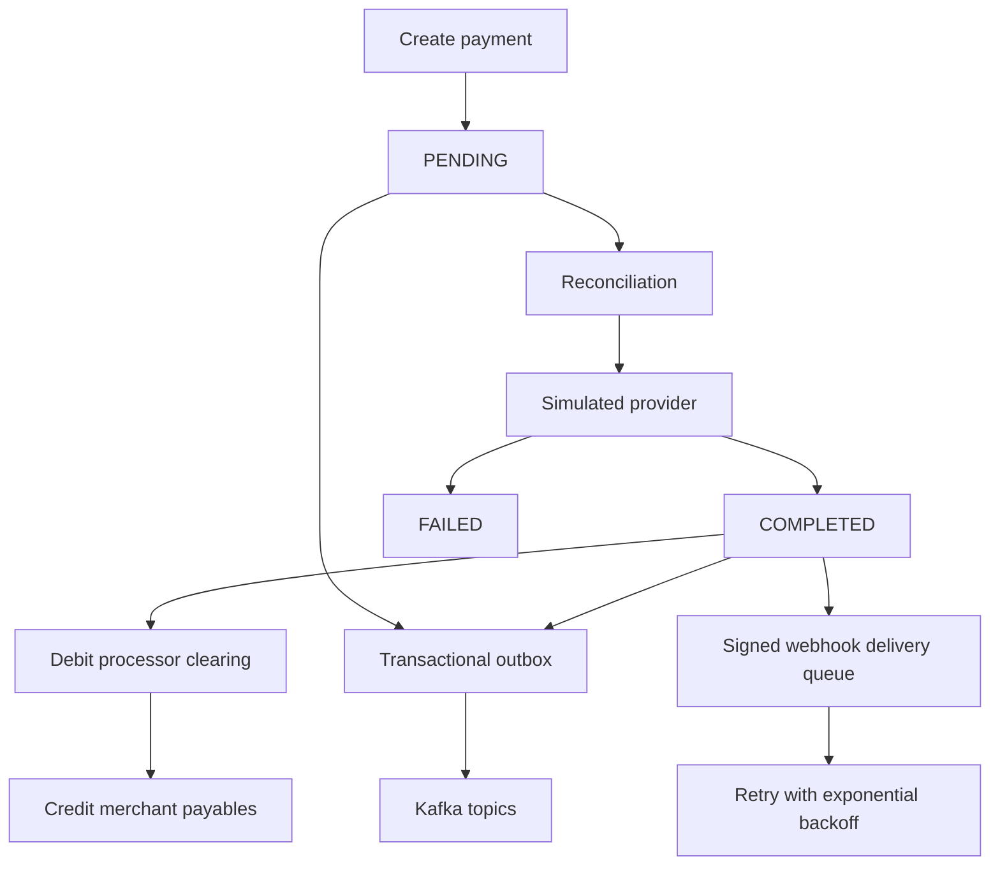

# FluxPay — payment operations sandbox

FluxPay is a portfolio project demonstrating a payment-processing API and operations dashboard. It uses simulated provider outcomes only: **it does not connect to a real payment network or move real money**.

## Feature overview

- Java 21 and Spring Boot 4.1.1 API
- User registration and login; BCrypt password hashing and short-lived HS256 JWT access tokens
- Authenticated, user-scoped payment listing and retrieval
- Request validation, payment-state transitions, and idempotency replay checks (same key + same payload replays; different payload returns `409`)
- PostgreSQL persistence with Flyway versioned migrations
- Transactional outbox for eventual Kafka publication and retry tracking
- Kafka `payment.created` and `payment.status_changed` topics
- Redis-backed fixed-window rate limiting, with an in-memory development fallback if Redis is unavailable
- Double-entry ledger pair for completed payments (processor clearing debit + merchant payable credit), written transactionally and protected by stable idempotency keys
- Simulated provider and reconciliation endpoint for pending/processing payments
- HMAC-SHA256 signed webhooks, delivery history, exponential retries, and a maximum attempt count
- Per-account audit events, consistent API error responses, Actuator health, and Swagger/OpenAPI
- React + TypeScript dashboard for payments, ledger, webhooks, and audit trail
- Docker Compose and GitHub Actions CI configuration

This is a strong learning/demo baseline, not a PCI-certified or production-ready payment processor. A production system would additionally require a threat model, external security review, managed secrets/KMS, durable broker configuration, database backup/restore procedures, stronger webhook egress controls, alerting, reconciliation policies, data retention policies, and extensive load/integration testing.

## Quick start with Docker (recommended)

Requirements: Docker Desktop with Compose enabled and network access for initial image/dependency downloads.

1. In the project root, copy `.env.example` to `.env`.
2. Replace the example `DB_PASSWORD` and `APP_JWT_SECRET` values in `.env`. Make the JWT secret a random value of at least 32 bytes. Do not commit `.env`.
3. Run:

   ```bash
   docker compose up --build
   ```

4. Open the dashboard at <http://localhost:4173>.
5. Register a user, sign in, create a test payment, then click **Run reconciliation**. Most simulated payments complete; a deterministic subset fail so you can inspect both outcomes.
6. API docs: <http://localhost:8080/swagger-ui.html>
7. Health endpoint: <http://localhost:8080/actuator/health>

The local compose configuration exposes PostgreSQL on `5432`, Redis on `6379`, Kafka on `9092`, the API on `8080`, and the dashboard on `4173`. The database, Redis data, and Kafka data use named Docker volumes.

To stop the stack:

```bash
docker compose down
```

To also delete local data volumes, use `docker compose down -v`. **That command permanently deletes the local demo database and broker data.**

## Run the API directly on your machine

Requirements: Java 21, Docker, and a PostgreSQL/Kafka/Redis service. The API can fall back to local rate limits when Redis is missing, but PostgreSQL is required. From the repository root:

```bash
# Start local infrastructure (PostgreSQL, Redis, Kafka only)
docker compose up -d postgres redis kafka

# Windows PowerShell
$env:DB_URL = 'jdbc:postgresql://localhost:5432/fluxpay'
$env:DB_USERNAME = 'postgres'
$env:DB_PASSWORD = 'your-local-password'
$env:APP_JWT_SECRET = 'replace-this-with-at-least-32-random-bytes'
$env:KAFKA_BOOTSTRAP_SERVERS = 'localhost:9092'
$env:REDIS_HOST = 'localhost'
./mvnw.cmd spring-boot:run
```

If you use the compose-defined PostgreSQL password, set `DB_PASSWORD=postgres` for the local demo. Never reuse that default outside a local sandbox.

## Run the frontend directly

```bash
cd frontend
npm install
npm run dev
```

Vite serves the dashboard on <http://localhost:5173>. It calls `http://localhost:8080` by default; set `VITE_API_BASE_URL` at build time if the API runs somewhere else. The API CORS list is controlled by `CORS_ALLOWED_ORIGINS`.

Production frontend build:

```bash
cd frontend
npm run build
```

## API quick reference

All routes below, except registration/login, require `Authorization: Bearer <token>`.

| Method | Endpoint | Purpose |
| --- | --- | --- |
| `GET` | `/api/v1/health` | Basic health response |
| `POST` | `/api/v1/auth/register` | Create a user (JSON: `username`, `password`) |
| `POST` | `/api/v1/auth/login` | Issue JWT (JSON: `username`, `password`) |
| `GET` | `/api/v1/dashboard/summary` | Payment counts and completed volume grouped by currency |
| `POST` | `/api/v1/payments` | Create a payment; send a unique `Idempotency-Key` header |
| `GET` | `/api/v1/payments` | List your payments |
| `GET` | `/api/v1/payments/{id}` | Retrieve one of your payments |
| `PATCH` | `/api/v1/payments/{id}/status` | Change status along allowed transitions |
| `POST` | `/api/v1/reconciliation/run` | Process your pending/processing payments through the simulated provider |
| `GET` | `/api/v1/ledger` | List your ledger entries |
| `GET` | `/api/v1/ledger/payments/{paymentId}` | Ledger entries for one of your payments |
| `POST` | `/api/v1/webhooks` | Register an HTTPS endpoint (local HTTP is allowed only for loopback) |
| `GET` | `/api/v1/webhooks` | List registered endpoints (secrets are not returned) |
| `GET` | `/api/v1/webhooks/deliveries` | Inspect webhook delivery and retry history |
| `GET` | `/api/v1/audit` | List your account's audit events |
| `GET` | `/v3/api-docs` | OpenAPI JSON |
| `GET` | `/swagger-ui.html` | Swagger UI |

### Example using PowerShell

```powershell
$body = @{ username = 'demo_user'; password = 'change-this-demo-password' } | ConvertTo-Json
Invoke-RestMethod -Method Post -Uri http://localhost:8080/api/v1/auth/register -ContentType 'application/json' -Body $body
$login = Invoke-RestMethod -Method Post -Uri http://localhost:8080/api/v1/auth/login -ContentType 'application/json' -Body $body
$headers = @{ Authorization = "Bearer $($login.token)"; 'Idempotency-Key' = [guid]::NewGuid().ToString() }
$payment = @{ amount = 1250.00; currency = 'INR'; customerEmail = 'customer@example.com' } | ConvertTo-Json
Invoke-RestMethod -Method Post -Uri http://localhost:8080/api/v1/payments -Headers $headers -ContentType 'application/json' -Body $payment
Invoke-RestMethod -Method Post -Uri http://localhost:8080/api/v1/reconciliation/run -Headers @{ Authorization = "Bearer $($login.token)" }
```

If you repeat a `POST /api/v1/payments` with the same key and same body, the original payment is returned. Reusing the key with a different body is rejected with `409 Conflict`.

## Payment lifecycle and ledger



The ledger records two equal positive amounts with opposite directions. It does not claim that the amount has actually settled with a bank or provider. Reconciliation is deterministic for repeatable demos rather than a connection to a payment processor.

## Configuration and secrets

`application.properties` contains safe local defaults only. Configure these environment variables for your own environment:

- `DB_URL`, `DB_USERNAME`, `DB_PASSWORD`
- `APP_JWT_SECRET` (at least 32 bytes; unique outside demos)
- `KAFKA_BOOTSTRAP_SERVERS`
- `REDIS_HOST`, `REDIS_PORT`
- `CORS_ALLOWED_ORIGINS`
- `RATE_LIMIT_AUTH_PER_MINUTE`, `RATE_LIMIT_PAYMENT_PER_MINUTE`

`.env` is ignored by Git. Do not place real secrets in source files, frontend code, issue trackers, or screenshots.

## Tests and verification

Unit tests that do not need infrastructure cover request fingerprint canonicalization, payment-state transitions and debit/credit balance rules:

```bash
./mvnw test
```

Frontend type-check/build:

```bash
cd frontend && npm install && npm run build
```

The integration context needs PostgreSQL and schema migrations; run the full stack with Docker Compose for manual verification. The authoring environment used to update this archive could not download Maven from Maven Central, and npm packages were not installed here, so the complete backend Maven build and frontend production build are **not claimed as verified**. See [`VERIFICATION.md`](VERIFICATION.md) for the checks that were completed and the remaining local verification steps. Run the commands above on your machine and review any reported error before treating the project as complete.

## CI

`.github/workflows/ci.yml` runs backend tests and the frontend type-check/build on pushes and pull requests. GitHub-hosted runners can download dependencies when the repository is public or CI has appropriate access.

## License

This project is provided for educational and portfolio use. Add a license file if you plan to redistribute it.
